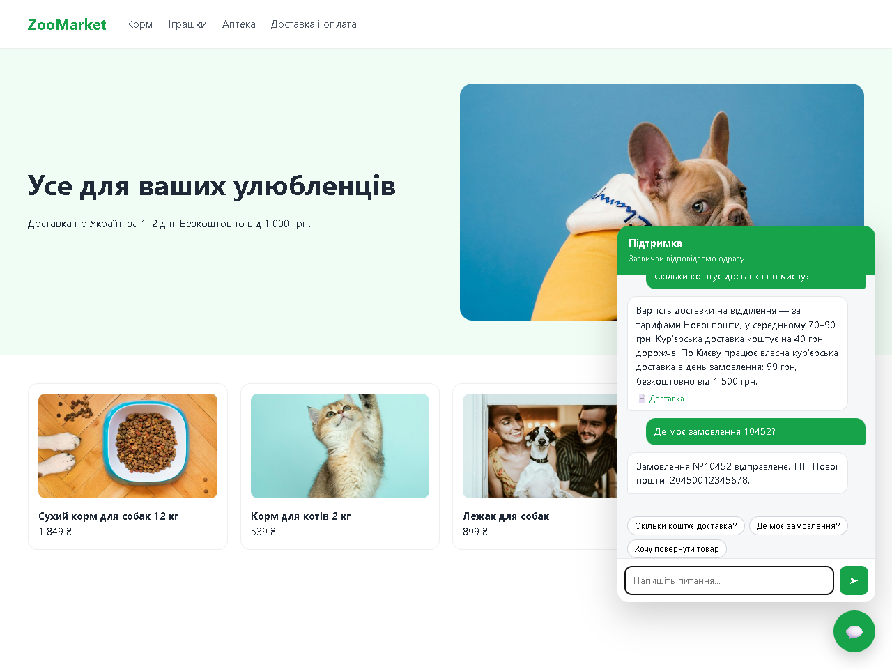
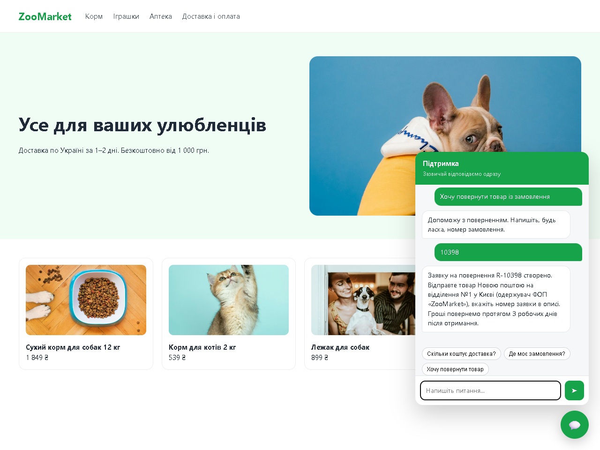
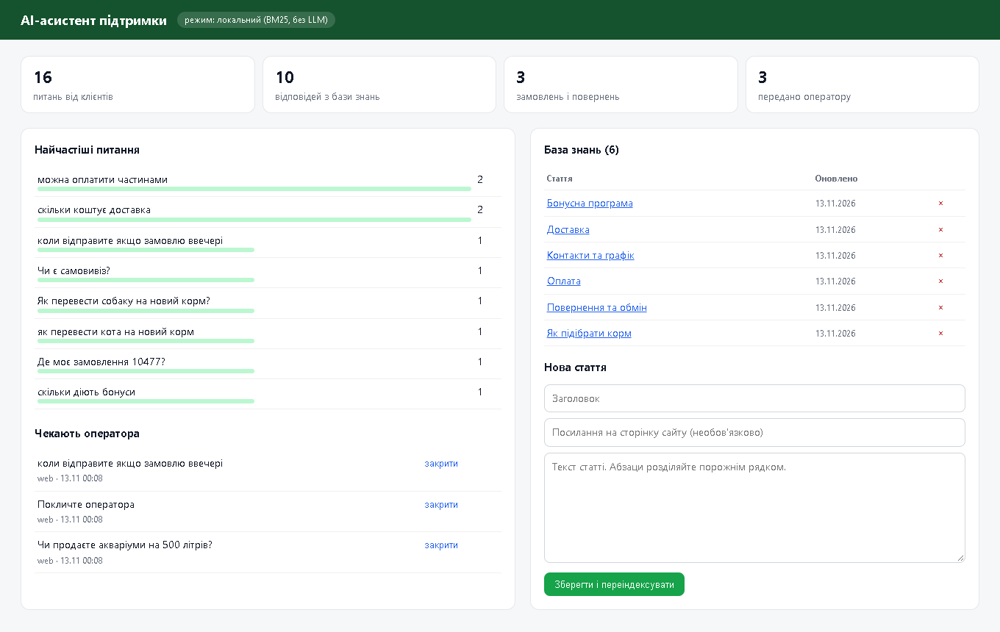

# AI-асистент підтримки для інтернет-магазину

Бот відповідає клієнтам на сайті, у Telegram і Viber: бере відповіді з бази знань магазину (з посиланням на джерело), перевіряє статус замовлення, оформлює повернення і кличе людину, коли не впевнений.

| Віджет на сайті | Повернення через чат |
| --- | --- |
|  |  |



## Як це влаштовано

```
повідомлення (сайт / Telegram / Viber)
        │
        ▼
  правила: номер замовлення? повернення? "покличте людину"?
        │ так                              │ ні
        ▼                                  ▼
  API магазину                     RAG по базі знань
  (статус, заявка на повернення)   пошук фрагментів → відповідь + джерело
                                           │ низька релевантність
                                           ▼
                                  тікет + сповіщення операторам у Telegram
```

- **Статус і повернення — без LLM.** Номер замовлення і статус беруться з API магазину, а не «генеруються», тож бот не вигадає, що посилка вже в дорозі.
- **RAG.** Статті ріжуться на фрагменти по абзацах. З ключем OpenAI — ембединги `text-embedding-3-small` і пошук у PostgreSQL через pgvector (`<=>`), відповідь пише `gpt-4o-mini` строго за фрагментами з посиланнями [1], [2].
- **Локальний режим без ключа.** BM25 з простим стемінгом для української + відповідь найрелевантнішими реченнями статті. На скріншотах — саме він.
- **Чесний поріг.** Якщо в базі знань немає відповіді, бот не фантазує, а передає питання оператору (тікет в адмінці + повідомлення в чат операторів).
- **Канали.** Веб-віджет (`static/widget.js`, підключається одним тегом), Telegram (aiogram 3), Viber (вебхук).
- **Панель** `/admin`: статистика, найчастіші питання, відкриті звернення, редагування бази знань — менеджер додає або змінює статтю, і вона одразу переіндексується, без програміста.

## Запуск

```bash
python -m venv .venv
.venv/bin/pip install -r requirements.txt
cp .env.example .env          # для локальної перевірки можна не заповнювати
uvicorn assistant.web:app --port 8000
```

- http://localhost:8000 — демо-сторінка магазину з віджетом
- http://localhost:8000/admin — панель (admin / admin)

При першому старті база знань наповнюється з `knowledge_base/*.md`.

Telegram-бот: `python -m assistant.telegram_bot` (потрібен `TELEGRAM_TOKEN`).
Viber: зареєструвати вебхук на `https://your-domain/viber/webhook`.

### PostgreSQL + pgvector

Вказати `DATABASE_URL` на Postgres, запустити застосунок (створить таблиці), потім виконати `migrations.sql`.

## Тести

```bash
pip install -r requirements-dev.txt
pytest -q
```

Перевіряють пошук потрібної статті, відповідь з джерелом, передачу оператору для невідомих питань, статус замовлення, повний сценарій повернення і відмову, якщо минуло більше 14 днів.

## Стек

Python, FastAPI, SQLAlchemy, OpenAI API, PostgreSQL + pgvector, aiogram 3, Viber REST API.
